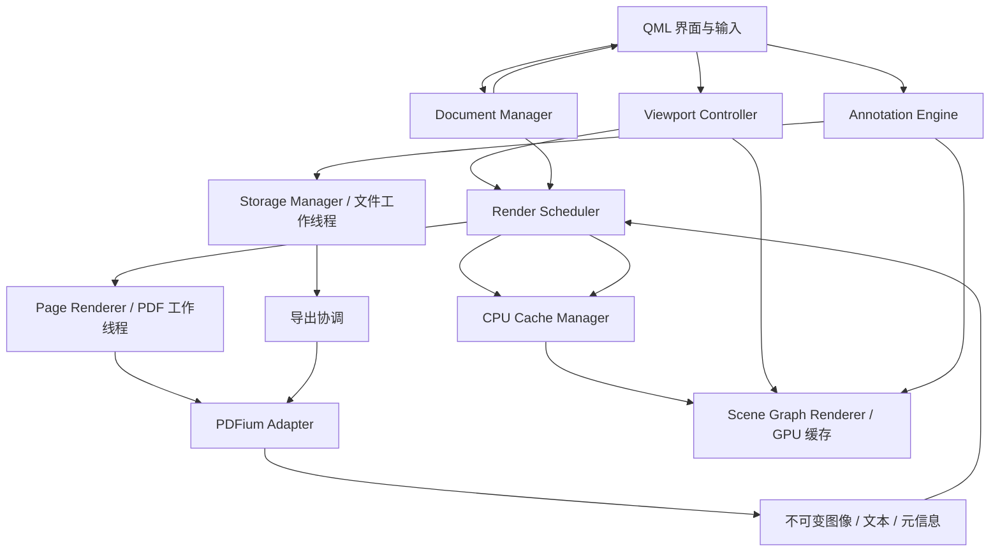

# 系统架构设计

## 阶段 1 实施契约（2026-10-15，编码前）

用户授权阶段 1，macOS 全部实机检查延至整个项目完成后。正式入口为 `src/app/`，QML 模块位于 `qml/Langlern/Shell/`；`langlern` 只链接 Qt，不链接、初始化或调用 PDFium。阶段 0 adapter 保留原型目录，待阶段 2 文档服务接口落地时迁移，避免现在把实验导出/调度接口固化为产品服务。共用的 C++20、Qt 版本与警告配置在根 CMake 管理，原型通过显式选项开启。

`ShellState` 在 UI 线程由入口栈拥有，先于 QML engine 创建、后于 engine 销毁。QML 通过必需的强类型属性访问它。它仅接收系统文件选择返回的本地 URL，校验路径/扩展名并保存文件名及诚实的“尚未加载”提示；不读取 PDF 内容，不创建文档会话或工作线程。文件路径不进入诊断日志。浅/深/跟随系统主题由一个状态源驱动，token 负责颜色；不在此阶段写配置文件。

普通启动没有应用自建周期 Timer、动画、字体扫描、后台预热或缓存。只记录 main、QML ready、首帧提交及一次合成快捷键往返；后三者使用同一单调时钟。首帧跨渲染线程通过 queued connection 回 UI，日志仅在 UI 线程输出。自动诊断的合成输入只表示 Qt 事件链响应代理，不等于系统输入或屏幕呈现。启动测量由进程外脚本记录启动请求和接收标记时间，保留采集延迟边界。文件对话框与帮助弹窗按需 Loader 创建。只使用 Qt 6.8 公共 API。

接口：`selectFile(QUrl)`、`clearSelection()`、`cycleTheme()`；状态 `selectedName`、`statusText`、`themeMode`、`dark`。快捷键：标准 Open/Quit、Ctrl/Command+W 清除选择、F1 帮助、Ctrl/Command+Shift+L 切换主题；禁用的未来工具不出现为可执行操作。窗口关闭无需等待 PDF 工作。系统 FileDialog 默认使用本机实现，取消不改变已有状态；首次创建后复用，以免在原生关闭回调内立即销毁 helper。帮助弹窗关闭后卸载。Qt 的 `Ctrl` 描述在 Apple 平台自动映射为 Command，不能改成 `Meta`，依据 [Qt 6.8 QKeySequence](https://doc.qt.io/qt-6.8/qkeysequence.html#detailed-description)。

使用 [qt_add_qml_module](https://doc.qt.io/qt-6.8/qt-add-qml-module.html) 的静态应用自有 QML 模块，Qt 本身保持动态链接；[FileDialog](https://doc.qt.io/qt-6.8/qml-qtquick-dialogs-filedialog.html) 默认本机实现；首帧来自 [QQuickWindow::frameSwapped](https://doc.qt.io/qt-6.8/qquickwindow.html#frameSwapped) 提交代理。仅供诊断的 F6 信号不读取文件或改变产品状态。

日期：2026-10-15。状态：规划已审阅；阶段 0 实施与验证记录见 PHASE0_REPORT.md，不代表产品功能完成。

## 阶段 0 实施契约（编码前确认）

原型全部置于 `prototypes/phase0/`，不建立未使用的产品模块。共用 `PdfWorker` 在唯一 QThread 中创建局部 RAII PDFium 环境、文档、页、文本页和位图。通过 QFile + FPDF_FILEACCESS 按需读取，避免窄路径编码及整本载入。单槽 mailbox 保存最新需求，原子 generation 可在 API 运行期间失效；UI 交付时再次校验。底层同步渲染不会被强制中断，过期仅丢弃结果。退出先失效，worker 异步清理完成后退出进程。

`RenderRequest` 包含 session/generation、path、page、pixel width；`RenderResult` 是 QImage 值快照和无句柄 JSON 元信息。像素预算集中在 Config，分配前检查；BGRA 位图写入 QImage ARGB32，白底使输出不含需要猜测的预乘透明度。纹理仅在 updatePaintNode 中创建，由节点拥有，重建时从 CPU 快照恢复。不实施正式 LRU、虚拟滚动或完整标注 UI。

CLI probe 使用相同 worker 执行渲染、坐标对照、文本和独立导出。导出采用 QSaveFile，拒绝已存在目标（同时防止硬链接别名覆盖）；新字体与路径对象在 worker 中创建，保存后重开验证。快照独立的小实验验证 QSaveFile 取消/提交和校验恢复，不代表完整 autosave。字体采用 OFL Noto 的固定来源，开发工具不链接进应用。外部 MuPDF 仅作为本地独立验证工具。

候选锁定 Qt 6.8.3 动态库、PDFium chromium/8100 非 V8/XFA 二进制；以实测和许可产物清单确认。Windows 用现有 MSVC，macOS 的 arm64 路径与 CI 定义可准备，但未实机执行不能通过门槛。

本文件遵循根目录 [AGENTS.md](../AGENTS.md)。实施顺序见 [ROADMAP.md](ROADMAP.md)，指标与实验方法见 [PERFORMANCE.md](PERFORMANCE.md)。除阶段 0 契约中已实施的原型外，本文中的产品类型、路径和接口仍为设计。实际依赖锁定和证据见 [DEPENDENCIES.md](../third_party/DEPENDENCIES.md)，不以滚动版资料代替所选版本审查。

## 1. 目标与范围

为 Windows x64 和 macOS Apple Silicon 提供离线 PDF 阅读与语言练习：连续阅读、缩放、导航、原生文字选择复制、透明文字答案、多色笔迹、擦除、撤销重做、自动保存恢复和导出新 PDF。

性能优先于交互效率，交互效率优先于视觉装饰。数百 MB 至 GB 级扫描教材是核心负载。启动不等待 PDF 初始化；打开文档不整本渲染；用户输入不重新解码 PDF。

固定采用 C++20、Qt 6 / Qt Quick / QML、PDFium C API、CMake。页面通过 Qt Quick Scene Graph 显示，由 Qt RHI 使用 Direct3D 11 / Metal。第一版不实现 OCR、AI、云同步、账号、复杂表单或修改原 PDF 内容。

## 2. 技术决策与验证状态

| 编号 | 决策 | 状态与理由 |
| --- | --- | --- |
| A01 | 一个 PDFium 专用工作线程，所有实例全局串行调用 | 已确定约束；官方头文件声明 API 非线程安全，并非只限制同一文档 [S1] |
| A02 | PDFium CPU 位图 → 不可变图像 → Scene Graph 纹理 | 待原型验证复制次数和图像格式；Qt 使用 GPU 合成不等于 PDFium 已进行 GPU 解码 |
| A03 | 使用公开 QQuickItem / QSGNode / QSGTexture 路径，暂不直接编写 QRhi 命令 | 降低版本和平台耦合；Qt 默认渲染器已经使用 RHI [S2] |
| A04 | 视口驱动任务，预览与目标清晰度分离 | 初步设计；用阶段 0/3 的首次显示、清晰度延迟与峰值内存验证 |
| A05 | 标注独立于 PDF 页面图像，统一使用页面空间数据 | 已确定原则；坐标实现需经旋转、裁剪和高 DPI 样本验证 |
| A06 | 初期使用可版本化的本地 JSON 快照及原子替换，导出写入独立 PDF 会话 | 初步设计；先验证故障恢复、数据量和 PDF 写入可行性，不立即引入数据库 |
| A07 | 初期为单窗口单活动文档；切换前处理未保存状态 | 最小交互设计，不扩展多标签、多窗口；底层仍用会话标识隔离资源 |
| A08 | Qt 优先动态链接；PDFium 优先可追溯的固定构建产物 | 候选方案；链接方式不等于许可义务已满足，阶段 0 完成审查后确认 |
| A09 | 橡皮擦第一版按整条笔迹删除，可一次手势删除多条 | 初步 MVP 决策；简化撤销和持久化，切割笔迹按反馈与性能另行评估 |

不在此时承诺零复制、不受限文件尺寸、确定的内存峰值或任意设备的 60 FPS。

## 3. 模块依赖与运行数据流

下图为运行时消息流，箭头不代表 CMake 链接依赖。



编译依赖方向：

1. `domain` 定义 ID、几何、标注值类型和错误，不依赖 QML、Scene Graph 或 PDFium。
2. `pdf` 封装 PDFium 并实现工作线程服务，依赖 `domain`，仅自身接触 PDFium 头文件。
3. `reader` 管理文档、视口、调度及 CPU 缓存，依赖 `domain` 和 `pdf` 服务；不依赖 QML。
4. `annotations` 实现标注与历史命令，依赖 `domain`。
5. `storage` 管理格式和文件写入，依赖 `domain`；导出协调通过 PDF 服务提交任务。
6. `quick` 将模型、图像及输入适配到 Qt Quick，依赖上述逻辑模块。
7. `app` 装配模块并加载 QML。QML 不直接读取磁盘或调用 PDFium。

以上是逻辑边界，初期可仅落成少量库，避免每个类单独建库。测试优先针对无窗口逻辑和真实引擎集成。

## 4. 建议目录与构建目标

以下目录按阶段创建，本次规划不生成空实现文件。

```text
langlern_pdf_editor/
├── AGENTS.md
├── CMakeLists.txt                 # 阶段 0 建立
├── CMakePresets.json              # 可共享配置，不含本机绝对路径
├── cmake/                        # 工具链检查、PDFium imported target、打包支持
├── src/
│   ├── app/                      # main、装配、平台启动集成
│   ├── domain/                   # ID、几何、标注、错误值类型
│   ├── pdf/                      # RAII adapter、worker、renderer、文本及导出
│   ├── reader/                   # document、viewport、scheduler、CPU cache
│   ├── annotations/              # 模型、命中测试、历史命令
│   ├── storage/                  # 格式、恢复、原子写入、导出协调
│   └── quick/                    # QML bridge、PageItem、场景图和 GPU cache
├── qml/
│   ├── Main.qml
│   ├── components/
│   ├── reader/
│   └── theme/
├── resources/                    # 图标、已审查字体、资源清单
├── prototypes/phase0/            # 技术验证入口，不作为完整产品
├── tests/
│   ├── unit/
│   ├── integration/
│   ├── quick/
│   └── fixtures/                 # 可公开的小型确定性 PDF 与生成脚本
├── benchmarks/                   # 真实引擎与交互实验驱动
├── tools/                        # 采样、样本生成、结果汇总
├── third_party/                  # 依赖来源、版本、校验值、通知文件
├── packaging/                    # Windows / macOS 部署
├── .github/workflows/            # 双平台 CI，按仓库托管方式确认
└── docs/
    ├── ARCHITECTURE.md
    ├── ROADMAP.md
    └── PERFORMANCE.md
```

候选目标：`langlern_domain`、`langlern_pdf`、`langlern_core`、`langlern_quick`、`langlern_pdf_editor`；阶段 0 先建立实际需要的 `phase0_pdf_probe`、`phase0_quick_probe`，核心逻辑成熟后再拆分。测试通过 CTest 注册，优先使用 Qt Test，性能驱动先使用计时与结构化日志，确有需要再引入独立基准库。

应用使用 CMake；PDFium 本身的上游构建流程并非 CMake [S7]。通过固定产物和 imported target 集成，不能假定 `find_package(PDFium)` 在干净环境可用。依赖下载不发生在应用运行时。实际构建命令仅在阶段 0 执行并验证后写入编译说明。

## 5. 主要契约、接口与所有权

下表是建议的应用级接口，不是上游 API 的逐字签名。异步请求返回 ID，通过结果事件完成；错误携带阶段、会话、页码和可读说明。

| 模块 | 建议接口 / 事件 | 所有权与关键约束 |
| --- | --- | --- |
| Document Manager | `open(path)`、`close(session)`；`opened`、`pageInfoReady`、`failed` | UI 线程管理状态，不拥有原生句柄；会话状态为 Opening / Ready / Closing / Closed / Error |
| PDFium Adapter | `openDocument`、`pageInfo`、`render`、`extractText`、`exportCopy` | 仅 PDF 线程可调用；RAII 对象也在该线程销毁，统一初始化和最终退出 |
| Viewport Controller | `setViewport`、`setZoom(anchor)`、`goToPage`、`mapToPage`；`demandChanged` | UI 线程纯计算；使用元信息快照，不为坐标转换同步调用 PDFium |
| Render Scheduler | `replaceDemand`、`cancelSession`；`imageReady`、`textReady` | UI 线程集中调度，不自建第二条 PDF 线程；限制队列、结果和在途资源 |
| Page Renderer | `render(RenderRequest)` → `RenderResult` | PDF 线程执行；输出无句柄的不可变像素和描述信息 |
| Cache Manager | `lookup(key)`、`admit(result)`、`setBudget`、`trim`；`stats` | CPU 缓存在调度线程；GPU 缓存在场景图所属线程，不共享 QSG 指针 |
| Scene Graph Renderer | `setPresentation(snapshot)`、`updatePaintNode`、资源失效处理 | QQuickItem 属性在 UI 线程，节点与纹理按 Qt 渲染生命周期管理 |
| Annotation Engine | `begin/update/commit/cancelGesture`、`apply(command)`、`undo/redo` | UI 线程模型；稳定标注 ID、页面索引、修订号；输入预编辑不直接持久化 |
| Storage Manager | `scheduleSave(snapshot)`、`load(identity)`、`export(snapshot,path)`；`saved/failed` | 文件线程写入值快照；PDF 导出阶段回到唯一 PDF 线程 |

公共数据契约至少包含：

| 类型 | 内容 |
| --- | --- |
| `DocumentSessionId` | 单调递增或唯一 ID；重新打开同一路径也生成新会话 |
| `PageInfo` | 零基页索引、有效页面边界、MediaBox / CropBox、旋转、单位归一信息及验证状态 |
| `ViewportState` | 逻辑像素视口、滚动偏移、缩放、DPR、布局修订、锚点 |
| `RenderKey` | 会话、页面、底图修订、分辨率档位、旋转、图块范围和渲染选项；标注修订不进入底图 key |
| `RenderRequest` | key、需求序号、优先级、取消标记、预计像素字节数 |
| `RenderResult` | key、需求序号、图像、有效覆盖范围、stride、格式、耗时、完成/失败状态 |
| `TextSnapshot` | 页面字符与可复制字符串映射、页面坐标字符框、阅读顺序信息、提取错误 |
| `AnnotationSnapshot` | schema 版本、文档身份、页面标注、字体引用、文档修订号 |

缓存 key 表示内容身份，需求序号表示当前展示意图，不能混为一谈。旧视口结果若 key 仍有效且属于当前需求，可复用；旧会话结果一律不可展示。

## 6. 线程模型与退出

| 执行域 | 工作 | 不允许的操作 |
| --- | --- | --- |
| UI / 主线程 | QML、交互、模型、视口、调度、CPU 缓存索引 | PDFium 调用、同步等待 PDF、整本文件读入或大快照序列化 |
| PDF 专用 QThread worker | 引擎初始化、文件读取回调、页面元信息、渲染、文本、导出和所有原生析构 | 操作 QML 或 QSG；在其他线程释放 PDFium 对象 |
| Qt Quick 渲染执行域 | 快照同步、节点、纹理、提交 | 访问 PDFium、读文件、等待后台解码 |
| 文件工作线程，阶段 7 引入 | 身份校验、快照序列化、原子写入和恢复读取 | PDFium 调用或回写 UI 模型 |

Qt 的实际渲染循环依平台和配置而异，不能假设一定有独立渲染线程。自定义图元仍按 Qt 的同步点与资源规则编写 [S3]。在 `updatePaintNode` 只同步已有数据，禁止解码、文件 I/O 或长任务。

PDF worker 每次只运行一个 API 调用或一个渐进渲染时间片。不要一次投递上千个不可重排的 queued slot：调度器保留有限待处理队列，worker 完成后请求下一项；可取消状态使用不依赖 worker 事件循环立即响应的标志。

单个 PDFium API 仍可能长时间运行。渐进渲染提供暂停/继续和清理入口 [S4]，但不保证页面解析、图片解压或保存均可抢占。阶段 0 测量此限制；第一版至少保证 UI 流畅及不显示过期结果，不能声称所有渲染都能即时中止。

退出流程：冻结新请求 → 异步完成或报告待保存修订 → 标记会话失效并取消排队任务 → 在 PDF 线程清理渐进状态、文本页、页面、字体、文档 → 销毁 PDFium → 停止 worker → 按 Qt 生命周期释放图形资源。UI 可显示关闭状态，但不调用阻塞等待来掩盖长任务。无法安全强杀库调用；超时应记录并保留恢复数据。

## 7. 文档打开、布局与虚拟化

1. 窗口可交互后发起打开；使用本地文件按需读取，不将 GB 文件复制成内存数组。
2. 先返回页数及首页必要元信息并请求预览；其余尺寸分批读取，允许被可见页任务打断。
3. 维护轻量页面几何索引；未知尺寸使用估计值，更新时保持当前页面和页内锚点，避免滚动跳跃。
4. 通过页面范围索引查找视口相交页；只为可见及配置化邻域实例化页面图元。几何元信息可为 O(页数)，位图、文本页句柄和纹理不能随总页数无界增长。
5. 滚动与缩放用布局变换即时响应。大坐标滚动在视口附近重定位图元坐标，避免长文档中图形浮点精度损失。

阶段 3 比较受控的自定义页面宿主与 Qt Quick 列表方案对变高页面、锚点和资源回收的效果，再定实现；不用全页 `Repeater` 创建整本控件。全局百分比缩放和适应页宽先提供，触控板手势按平台验证。

文件路径和回调必须验证中文、空格、长路径、只读文件和大文件偏移。对于 Windows 上 `unsigned long` 大小导致的接口边界，按锁定版本审查；不宣称支持无限文件大小。损坏、受密码保护或权限受限的文档返回明确状态，第一版不增加复杂解密或表单功能。

## 8. 调度、清晰度和内存预算

优先级：关闭/取消等控制请求 → 当前缺失的可见预览 → 可见页目标分辨率及主动文字选择 → 邻近预加载 → 缩略图或非关键元信息。优先级内保留公平性，防止长时间饿死控制和保存任务。

每次需求变化重算所需 key，去重、合并、删除过期排队任务；在途结果交付前重新校验。静止后的清晰化使用延迟与分辨率档位防抖，所有参数集中配置并由实验确定。

初期以有上限的整页预览建立正确链路；在高分辨率整页超过单任务预算或设备纹理限制时，选择图块或降低预览分辨率。图块使用一致栅格原点、裁剪和边缘重叠，避免接缝；分块不保证 PDFium 内部只解压对应图片区域，必须测量实际 CPU 与内存。

CPU 与 GPU 分别采用预算化 LRU，另设在途、待上传、文本和历史命令预算：

```text
应用可控像素驻留 = CPU 缓存 + worker 在途 + 待上传 + 被展示快照引用的图像
GPU 受管估算 = 纹理分配 + 替换时旧新纹理重叠 + 待安全释放纹理
总进程内存还包括 PDFium 内部、Qt、字体、标注及驱动，不能用缓存计数代替
```

先预留预计字节再分配，失败时降分辨率/停止预加载/回收；可见资源被 pin 时也计入预算，不能把 pin 解释为无限超额权限。回收未使用资源后仍无法满足，应降低清晰度并报告。纹理上传每帧限额，防止后台突发结果拖慢一帧。

缓存释放时区分从索引移除、所有引用释放、GPU 延迟销毁三种状态。预算数值在阶段 0 记录候选参数及测量结果，阶段 3 再确认默认值。

## 9. 场景图与图像格式

PDFium 输出应用持有缓冲区，worker 渲染完成后关闭 bitmap 包装，图像作为只读结果跨线程传递；具体可否直接包裹 QImage 取决于 stride、字节序和 alpha，阶段 0 用色卡和透明样本验证。必要的一次转换应记录，不能强行将不匹配格式重解释。

渲染侧通过 `QQuickWindow::createTextureFromImage` 等公开路径创建纹理。节点或专用渲染线程缓存明确拥有纹理，禁止同一纹理被多个 owner 重复删除。UI 仅接收统计快照，不持有纹理指针。窗口隐藏、切换屏幕、场景图失效后支持由 CPU 数据重建。

节点树回收和 `releaseResources()` 的执行条件不同，不能在 UI 回调直接删除渲染资源；依 Qt 规则安排清理 [S3]。先使用内置纹理节点和矩阵变换；没有测量证据时不引入自定义 shader 或直接 RHI 资源操作。

## 10. 页面坐标与显示层

持久化空间为未应用阅读器滚动、缩放和视图旋转的 PDF 页面空间，以 PDFium 所选版本返回的有效几何为准；不把 CropBox 左下角强制当作所有文档的 `(0,0)`。常见页面 x 向右、y 向上；Qt 页面图元 x 向右、y 向下。记录原始边界、`/Rotate`、非默认 `/UserUnit` 等信息如何归一；不能把所有文件都假设为 1 单位 = 1/72 英寸。

对列向量定义：

```text
viewportPoint = T_scroll × T_layout × S_zoom × R_page × C_page × pdfPoint
devicePoint   = S_DPR × viewportPoint
pdfPoint      = inverse(M_pdf_to_viewport) × viewportPoint
```

`C_page` 包括有效裁剪、单位归一和 y 翻转；`R_page` 包含页面自身旋转和视图旋转的去重组合及平移补偿。布局和命中使用逻辑像素，DPR 只决定栅格分辨率。字体大小、笔宽与笔迹点保存在页面空间。

在 worker 中用 PDFium 的 PageToDevice / DeviceToPage 对照检查自有矩阵 [S1]，不在 UI 调用引擎。覆盖非零原点、负边界、混合尺寸、0/90/180/270 度、非默认单位及 DPR 1/1.25/1.5/2。纯矩阵往返误差目标 ≤ 1e-6 页面单位；与整数设备坐标 API 的比较允许 1 设备像素舍入误差。

阶段 0 观察：当前 PDFium 对 UserUnit=2 的样本仍返回 570×780 页面单位，而 MuPDF 的物理显示尺寸翻倍。故不能把 PDFium 的 width/height 直接解释为已归一的物理 points。持久化保留原始 PDF 页面单位，用 worker 生成的坐标变换基底作 UI 映射；物理尺寸/字号需明确 UserUnit。现阶段仅验证原始坐标添加内容并保留 UserUnit 的导出一致性，没有实现完整产品 PageInfo 归一器。CropBox 省略时回退 MediaBox，不能把合法文档报错。

每页显示层由下至上：PDF 底图 → 原生文字选择高亮 → 笔迹与非编辑文字答案 → 当前文字编辑器及选择手柄。文字和笔迹相对顺序由稳定 z 顺序定义，导出遵循同一顺序。

QML 编辑器只为活跃编辑项及必要可见项创建，其他文字使用轻量显示。统一 `TextLayoutSpec` 记录字体、字号、宽度、行高、基线、换行和方向；显示和导出共享排版定义，不能假设 PDFium 与 Qt 的文本排版天然一致。

## 11. 文字选择与输入仲裁

原生文字提取基于字符位置和 Unicode 映射 [S5]。字符索引不一定等于 QString 的 UTF-16 索引，必须处理代理对、连字、空白、裁剪区外文字和阅读顺序；没有文字层就不提供虚假选择区域。先保证标准横排及跨行/跨页复制，复杂布局记录限制，不能以 OCR 补范围。

| 上下文 | 按下 / 拖动 / 释放行为 |
| --- | --- |
| 已有活跃编辑器 | 原生文本编辑、IME、选区优先；全局单字母快捷键禁用 |
| 画笔模式 | 页面内采样笔迹，取消则不提交；不创建文本框 |
| 橡皮擦模式 | 命中笔迹，整个手势形成一个可撤销删除命令 |
| 选择模式 | 原生文字命中后拖动选择；空白拖动按手势规则滚动 |
| 输入/练习模式 | 已有答案优先命中；原生文字命中并拖动进入文字选择；空白处释放且未超拖动阈值才创建答案 |
| 触控板、滚轮或平台滚动手势 | 交由视口，滚动不因空白点击候选而创建输入框 |

中文预编辑属于编辑器临时状态，提交后才进入标注模型；输入时 Ctrl/Cmd+Z 优先交给当前编辑器，提交结束后由标注历史管理。移动框、完成笔迹、擦除分别作为一条历史命令，编辑输入按事务合并；历史必须有预算，模型数据不因历史淘汰而消失。

## 12. 本地保存、恢复与导出

初步保存到应用数据目录的文档工作区，不要求原 PDF 目录可写。文档身份包含规范路径、大小、修改时间与分段指纹；分段指纹只是候选匹配，首次后台完成全内容散列后建立强校验。打开不等待全文件散列，元信息或指纹不一致时不得悄悄将答案套到新文档；先隔离并提示重新关联。原文件被移动时可在用户重新选定后用强校验匹配。全文件散列在文件线程低优先级执行，不与首屏抢占磁盘。

快照含 schema 版本、身份、页面信息、稳定标注 ID、PDF 坐标、文本样式、笔迹及修订。文件线程序列化不可变快照，写同目录临时文件后原子提交，保留上次有效版本；平台断电持久性需独立验证，原子重命名不等于已保证断电不丢数据。

去抖自动保存加最大未保存时间，具体参数实验确定；状态区区分“已编辑、保存中、已保存、失败”。只按实际落盘修订更新状态，旧保存完成不得覆盖新状态。损坏或较新 schema 只读保留，不用空数据覆盖。大快照的复制、序列化及恢复不能回到 UI 阻塞执行。

导出基于一个确定的已提交标注快照，在唯一 PDF 线程打开独立的原文档会话，添加文字/路径内容，生成内容并保存新文件。候选 API 来自 `fpdf_edit.h` 与 `fpdf_save.h` [S6]。不直接变更阅读会话，不整本栅格化；保留底图与原文内容，新增对象作为练习结果固化，不承诺第三方阅读器能再次编辑这些答案。

字体与 Qt 排版差异是阻断风险：阶段 0 必须验证可分发/可嵌入字体、中文及拉丁文、组合字符、基线、换行、透明度和旋转。必要的受控字体与 glyph 布局方案要先评估授权和复杂度；不得静默换成图片或轮廓而声称文字导出已正确实现。

导出为独立操作，允许用户继续编辑，完成时注明导出修订。采用分页面生成以便在调用之间让出执行；单次保存可能长时间独占 PDF worker，先如实提示并测量，不能用第二条 PDF 线程绕过约束。目标与原文件通过规范路径及文件身份检查，防止硬链接/别名覆盖；先写目标目录临时文件，完成并复核后提交。已存在目标应经明确覆盖操作处理，任何失败均保留原 PDF 与练习快照。

## 13. 风险清单与前置门槛

| 风险 | 验证方法与完成门槛 | 时点 |
| --- | --- | --- |
| Qt / PDFium 二进制与许可证 | 固定版本、ABI/CRT、架构、构建配置、通知清单；来源和校验值可追溯 | 阶段 0，产品集成前 |
| PDFium 非线程安全、回调与析构 | 所有调用记录线程 ID，打开/取消/关闭压力实验，无跨线程释放 | 阶段 0，后续持续回归 |
| Scene Graph 资源生命周期 | D3D11 / Metal 真机色卡、透明度、隐藏重显、销毁重建，无失效访问 | 阶段 0，两平台分别验证 |
| 首页解析 / 内存尖峰 | 实际大扫描 PDF，记录打开、首像素、高清完成、引擎内部内存 | 阶段 0，参数调优延至阶段 3 |
| 取消不能抢占解压 | 长页渲染中切换目标，测量 worker 重新服务延迟 | 阶段 0；必要时评估渐进/分块 |
| 非标准页面坐标 | 旋转、裁剪、单位、高 DPI 对照样本和导出回读 | 阶段 0 定约定，阶段 5 完整回归 |
| 中文与字体导出 | PDFium 写入真实答案，至少两个独立查看器检查，重开提取及位置校验 | 阶段 0，未解不能宣布技术路线通过 |
| 本地恢复可靠性 | 写入中断、磁盘满、旧快照与格式版本实验 | 阶段 0 小验证，阶段 7 完整实现 |
| 依赖平台缺失 | 硬件/runner 可用性及实际构建报告 | 未执行平台保持待验证，不算通过 |

可延后：图块最优尺寸、缩放档位、LRU 参数、方向预加载、笔迹细分与批次优化、复杂 shader。不能延后：许可证路径、线程所有权、基本图像正确性、坐标契约、导出可行性和真实构建链。

## 14. 官方资料与证据边界

以下资料于 2026-10-15 查阅。它们支持 API 约束及验证方向，不构成本项目已验证或已合规的结论。阶段 0 将引用替换或补充为选定版本/提交的永久链接。

- [S1：PDFium fpdfview.h，线程、生命周期、坐标与文件接口](https://pdfium.googlesource.com/pdfium/+/refs/heads/main/public/fpdfview.h)。
- [S2：Qt Quick Scene Graph 默认渲染器与 RHI](https://doc.qt.io/qt-6/qtquick-visualcanvas-scenegraph-renderer.html)。
- [S3：QQuickItem 场景图同步与图形资源处理](https://doc.qt.io/qt-6/qquickitem.html)。
- [S4：PDFium 渐进渲染接口](https://pdfium.googlesource.com/pdfium/+/refs/heads/main/public/fpdf_progressive.h)。
- [S5：PDFium 文本接口与字符位置](https://pdfium.googlesource.com/pdfium/+/refs/heads/main/public/fpdf_text.h)。
- [S6a：PDFium 编辑与字体接口](https://pdfium.googlesource.com/pdfium/+/refs/heads/main/public/fpdf_edit.h)，[S6b：保存接口](https://pdfium.googlesource.com/pdfium/+/refs/heads/main/public/fpdf_save.h)。
- [S7：PDFium 上游构建说明](https://pdfium.googlesource.com/pdfium/+/refs/heads/main/README.md)。
- [S8a：Qt 授权概览](https://doc.qt.io/qt-6/licensing.html)，[S8b：Qt LGPL 注意事项](https://doc.qt.io/qt-6/lgpl.html)，[S8c：PDFium LICENSE](https://pdfium.googlesource.com/pdfium/+/refs/heads/main/LICENSE)。
